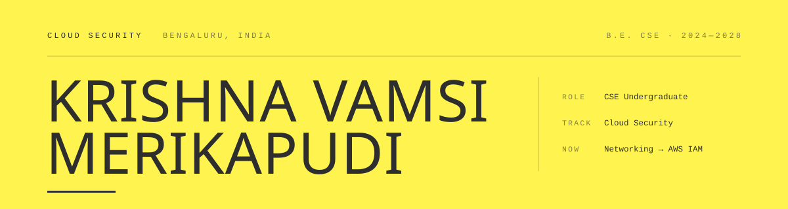
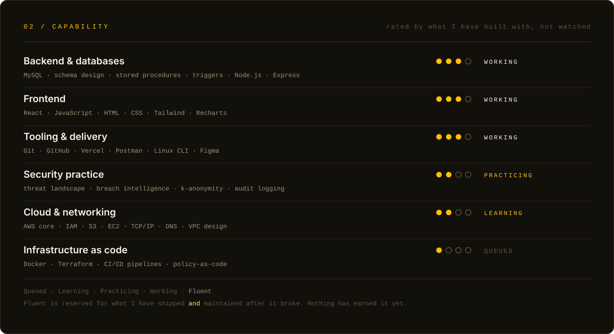

<picture>
  <source media="(prefers-color-scheme: dark)" srcset="assets/masthead-dark.svg">
  <source media="(prefers-color-scheme: light)" srcset="assets/masthead-light.svg">
  
</picture>

**Most breaches aren't clever.** They're a permission nobody scoped and a log nobody kept. Boring causes, expensive consequences — I'd rather work on the boring part.

**[Portfolio ↗](https://portfoliomkv.vercel.app/)**&nbsp; · &nbsp;[Source ↗](https://github.com/Krishnavamsi0018/Portfolio-MKV)&nbsp; · &nbsp;press **⌘/Ctrl + P** on the site for a one-page résumé

| | |
| :--- | :--- |
| **Based** | Bengaluru, India |
| **Track** | Cloud security — identity, network boundaries, the logging layer |
| **Right now** | Networking fundamentals → AWS IAM |
| **Open to** | Internships · security research · anything with real stakes |
| **Degree** | B.E. Computer Science & Engineering, Brindavan College · graduating Feb 2028 |

---

### `01 / BRIEF`

I'm a Computer Science undergraduate a few semesters from a degree and considerably further from knowing everything. What I've worked out so far is that I like systems where a mistake costs something — which is a short description of both why I build and why I ended up pointed at cloud security.

So I build things with **something worth protecting**, then go hunting for the assumptions I got wrong. A restaurant POS moving real money taught me more about referential integrity and tamper-evident logs than any lecture did. A breach-lookup tool taught me you can answer *"was I exposed?"* without ever receiving the thing that identifies you.

Certifications are on the calendar; the projects come first, because I'd rather explain a design decision than recite a service list. Off the keyboard: cricket, video editing, and following a curiosity too far.

> `01`&nbsp;&nbsp;Least privilege is a design decision, not a cleanup task.
>
> `02`&nbsp;&nbsp;If it isn't logged, it didn't happen — and you can't prove it didn't.
>
> `03`&nbsp;&nbsp;Put the guarantee in the database, not in the hope that the app behaves.
>
> `04`&nbsp;&nbsp;Ship it. Then try to break it yourself, before someone less friendly does.

---

---

### `03 / EVIDENCE`

Claims are cheap. Four builds — every one live, open-source, or both. Each entry leads with the single thing it proves.

<code>E—01</code>&nbsp;&nbsp;<b>Crunch &amp; Bubbles</b>&nbsp;&nbsp;·&nbsp;&nbsp;Restaurant POS &amp; analytics&nbsp;&nbsp;INTEGRITY

 

> **What it proves** — Real money moves through this. The guarantees live in the database — transactions, constraints, an append-only history — not in a hope that the application layer behaves.

A production-grade dine-in point of sale, built from an empty schema. I treated it as a data-integrity problem first and a UI second: if the numbers can't be trusted, the dashboard on top is decoration.

| | |
| :--- | :--- |
| **Schema** | Normalized MySQL. Bills and Payments are decoupled, so one bill settles across cash + UPI natively and refunds are first-class rows rather than negative-number hacks. `ON DELETE RESTRICT` / `SET NULL` keeps financial history from being orphaned. |
| **Transactions** | Stored procedures wrap multi-step order placement and stock depletion in explicit `COMMIT` / `ROLLBACK` blocks with error handlers. A half-written order can't exist. |
| **Audit** | Triggers capture row state as JSON snapshots into an immutable `AuditLog`. Every change carries a before and an after — the difference between suspecting tampering and proving it. |
| **Automation** | Ingredient quantities decrement in real time as orders land. Scheduled MySQL Events run nightly maintenance and fire low-stock alerts without an external cron. |
| **Analytics** | Window functions (`RANK`, `LAG`) surface peak hours and per-staff performance directly in SQL. |
| **Interface** | React 19 dashboard — floor-table mapping, a live kitchen board, Recharts visualisations, and a print-ready thermal bill. |

`MySQL` `Node.js` `Express` `React 19` `Recharts`&nbsp; · &nbsp;Apr – May 2026

**[Live portal ↗](https://restaurant-app-delta-gold.vercel.app/admin)**&nbsp; · &nbsp;[Source ↗](https://github.com/Krishnavamsi0018/restaurant-app)&nbsp; · &nbsp;sign-in required

<code>E—02</code>&nbsp;&nbsp;<b>CipherSelf</b>&nbsp;&nbsp;·&nbsp;&nbsp;Personal privacy intelligence&nbsp;&nbsp;PRIVACY

 

> **What it proves** — You can tell someone they've been breached without ever receiving the thing that identifies them. k-anonymity, applied rather than cited.

Built for Vibexathon 1.0. It checks an address against known breach corpora, scores the result, then does something more useful than a red banner: it shows what the exposure is worth to someone buying it.

| | |
| :--- | :--- |
| **Lookup** | Breach detection through the XposedOrNot API using a k-anonymity range query — only a hash prefix leaves the client, so the full identifier is never transmitted or stored. |
| **Scoring** | A composite DNA Score (0–100) weighing breach count, recency and the sensitivity of leaked field classes, so a leaked password and a leaked newsletter signup don't count the same. |
| **Framing** | Dark-web valuation in ₹ — abstract risk translated into a number people actually react to. |
| **Simulation** | An adversary walkthrough that chains the specific exposures found, turning a report into a threat model. |

`React` `Vite` `Node.js` `XposedOrNot` `Groq`

**[Live site ↗](https://cipherselfproject.vercel.app/)**&nbsp; · &nbsp;try `demo@cipherself.in` · source not public

<code>E—03</code>&nbsp;&nbsp;<b>CodeBeta</b>&nbsp;&nbsp;·&nbsp;&nbsp;AI-assisted coding curriculum&nbsp;&nbsp;SECRETS

 

> **What it proves** — The credential stays on the server. The obvious version of this app ships a paid API key to every visitor's browser; this one doesn't.

A gamified learning platform with XP progression, graded challenges and a tutor that answers in context. The interesting engineering isn't the lessons — it's the boundary between the browser and the model.

| | |
| :--- | :--- |
| **Boundary** | All model calls route through a Node.js proxy. The client posts a question to my endpoint; the key, the provider and the prompt scaffolding never leave the server. |
| **Tutor** | Groq-hosted inference for low-latency answers, scoped to the lesson the learner is on rather than answering anything asked of it. |
| **Progression** | XP-based advancement across challenges and languages, with state that survives a refresh. |

`JavaScript` `Node.js` `Groq API` `Vercel`

**[Live site ↗](https://code-beta-phi.vercel.app/)**&nbsp; · &nbsp;[Source ↗](https://github.com/Krishnavamsi0018/code-beta)

<code>E—04</code>&nbsp;&nbsp;<b>This portfolio</b>&nbsp;&nbsp;·&nbsp;&nbsp;Hand-built, zero dependencies&nbsp;&nbsp;CRAFT

 

> **What it proves** — Restraint, and that motion can carry an argument. One HTML file, no framework, no build step, and no third-party request of any kind.

A lemon-and-ink typographic system where the interaction makes the same point as the writing. The intro evaluates an access policy before letting you in; every block arrives with an *allow* flash; on a phone the case studies become a deck you swipe through and open as sheets.

| | |
| :--- | :--- |
| **Dependencies** | Zero. The fonts are self-hosted, so opening the page contacts nobody — no analytics, no tracking, no cookie banner to decline. |
| **Motion** | Liquid type through SVG filters, a scroll-driven card stack, and marquees whose speed follows your scroll. Native CSS and a single rAF loop. |
| **Access** | Semantic landmarks, a ⌘K command palette, visible focus rings, 44px touch targets, and full `prefers-reduced-motion` and `prefers-reduced-data` support. |
| **Extras** | A session audit log that never leaves the tab, redaction bars over anything address-shaped, a security-themed 404, and `Ctrl+P` for a one-page résumé. |

`HTML` `CSS` `Vanilla JS` `SVG filters`

**[Live site ↗](https://portfoliomkv.vercel.app/)**&nbsp; · &nbsp;[Source ↗](https://github.com/Krishnavamsi0018/Portfolio-MKV)

---

### `04 / TRAJECTORY`

Graduating February 2028. Written down so it's harder to drift from.

| Phase | Status | Focus |
| :--- | :--- | :--- |
| **01 · Build the base** 2024 – 2025 | `Complete` | Core languages, Git, a deploy pipeline that isn't manual. Relational modelling — keys, constraints, normalization. First projects shipped and publicly live. |
| **02 · Turn toward the cloud** 2026 – 2027 | `In progress` | Networking fundamentals — TCP/IP, DNS, routing, TLS. AWS core, then IAM and VPC design properly. Linux administration. Cloud Practitioner → Security+. Threat-model my own projects and publish the findings. |
| **03 · Do it for real** 2027 – 2028 | `Next` | A cloud security or DevSecOps internship. Terraform, policy-as-code, CI security gates. Container and Kubernetes security. AWS Security Specialty. Contribute to an open-source security tool. |

<b>Credentials</b>

 

| | |
| :--- | :--- |
| Cybersecurity Job Simulation | Deloitte |
| Cybersecurity Job Simulation | Forage |
| Introduction to the Threat Landscape 3.0 | FDF |
| Python for Data Science | Certification |
| Member | IEEE |
| B.E. Computer Science & Engineering | Brindavan College · 2024–2028 |

---

### `05 / CONTACT`

Open to internships, security research, or a straight conversation about where to go deeper next. I read everything.

**Colophon** — Masthead and capability card drawn by hand as SVG, in the same lemon-and-ink palette as the portfolio. Languages: English, Telugu, Hindi, Kannada, Tamil. Bengaluru, India.
